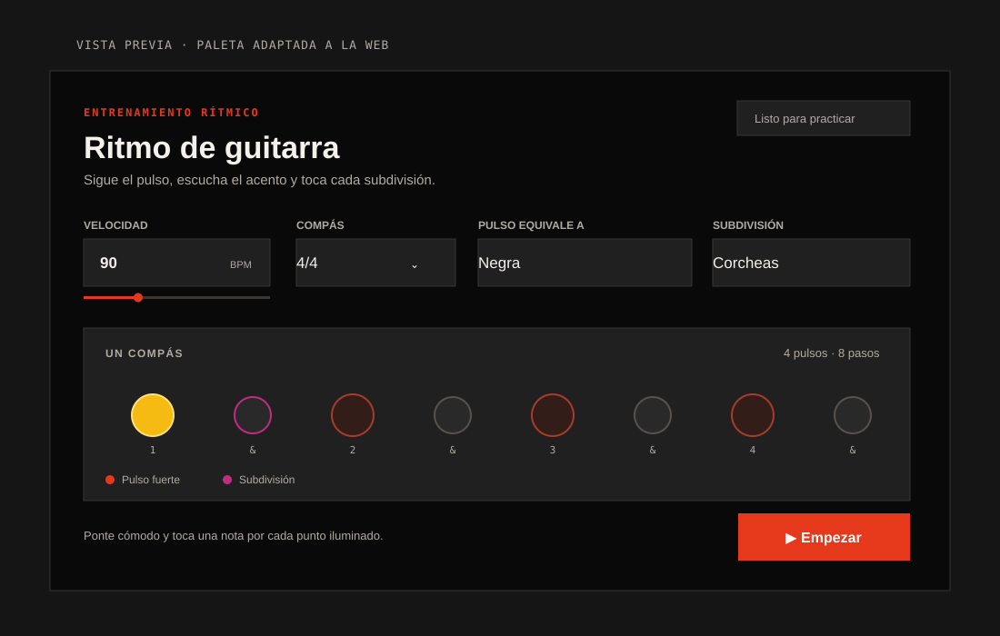

# Guitar Rhythm Trainer / Herramienta de ritmo para guitarra

> A small WordPress product for practicing guitar rhythm with audio and visual feedback.  
> Una pequeña herramienta para WordPress que permite practicar ritmo de guitarra con guía visual y sonido.

**Live app:** [pblo.es — Guitar rhythm practice](https://www.pblo.es/experimentos/un-producto-para-aprender-a-tocar-la-guitarra-electrica/)  
**Repository:** WordPress shortcode plugin · PHP · vanilla JavaScript · CSS

---

## English

### Product overview

Electric guitar learners need to keep a steady pulse while moving between quarter notes, eighth notes, sixteenth notes, and triplets. This MVP puts tempo, meter, subdivision, sound, and a synchronized visual guide in one responsive practice tool.

This is a product hypothesis and an implemented MVP, not a claim of validated user research or measured impact.

### Product goal

Help a learner start a focused rhythm exercise quickly, hear the difference between the main pulse and its subdivisions, and follow each step visually while playing.

### MVP scope

- Tempo control from 30 to 240 BPM, with a number field and slider.
- Time signatures: 2/4, 3/4, 4/4, and 6/8.
- Pulse unit: quarter note, or dotted quarter in 6/8.
- Subdivisions: quarter notes, eighth notes, triplets, and sixteenth notes.
- A stronger click on each pulse and an extra accent on the first beat of the bar.
- A step-by-step visual guide, responsive layout, keyboard-accessible controls, and live status announcements.
- Audio synthesized in the browser with the Web Audio API. No audio files, external libraries, analytics, or user data collection.

### Product decisions

- **Audio starts after a user action.** This supports browsers that require a tap or click before playback and keeps the learner in control.
- **Pulse and subdivision are separate settings.** This lets the learner change the note unit used by the BPM and then practice subdivisions against it.
- **6/8 supports two common ways to feel the bar.** Dotted quarter gives two pulses per measure; quarter note gives six.
- **One visual step represents one audible event.** The active step lights up in sync with the scheduled click.
- **The scope stays focused on a single repeating bar.** Count-in, custom accents, saved routines, and progress tracking are outside this MVP.

### What to validate next

No analytics or user study is included. A next product iteration could test the tool with guitar learners and measure:

1. Time from opening the page to starting a practice session.
2. Whether learners can correctly follow each subdivision at a chosen BPM.
3. Session completion and repeat use.
4. Which meters and subdivisions learners use most, using privacy-conscious measurement only if needed.

These are proposed validation signals, not results.

### WordPress installation

1. Upload this repository as a ZIP through **Plugins → Add New → Upload Plugin**, or copy the plugin folder into **wp-content/plugins/**.
2. Activate **Ritmo de guitarra**.
3. Add a **Shortcode** block to a post and insert the following shortcode:

    [ritmo_guitarra]

The plugin enqueues its CSS and JavaScript only when the shortcode is rendered. It requires WordPress 5.8+ and PHP 7.4+.

### Technical notes and limitations

- No framework or third-party dependency is required.
- Audio timing uses the Web Audio API scheduler; the visual state follows the scheduled audio events.
- The browser needs a user gesture to enable audio.
- The MVP has no count-in, tempo ramp, custom accent pattern, saved settings, or analytics.
- Test the plugin with the active WordPress theme, since themes may apply global form and button styles.

### Tech stack

WordPress · PHP · JavaScript · Web Audio API · CSS

### License

The plugin header declares **GPL-2.0-or-later**, in keeping with WordPress plugin conventions. See the [GNU GPL version 2](https://www.gnu.org/licenses/old-licenses/gpl-2.0.html).

---

## Español

### Resumen del producto

Quienes están aprendiendo guitarra eléctrica necesitan mantener un pulso constante mientras practican negras, corcheas, semicorcheas y tresillos. Este MVP reúne tempo, compás, subdivisión, sonido y una guía visual sincronizada en una herramienta adaptable a móvil.

Es una hipótesis de producto materializada en un MVP; no implica que se haya validado mediante investigación con usuarios ni que se hayan medido resultados.

### Objetivo del producto

Ayudar a empezar un ejercicio rítmico rápidamente, distinguir por el oído el pulso principal de sus subdivisiones y seguir visualmente cada paso mientras se toca.

### Alcance del MVP

- Control de tempo de 30 a 240 BPM, con campo numérico y deslizador.
- Compases: 2/4, 3/4, 4/4 y 6/8.
- Unidad de pulso: negra o, en 6/8, negra con puntillo.
- Subdivisiones: negras, corcheas, tresillos y semicorcheas.
- Clic más marcado en cada pulso y acento adicional al inicio del compás.
- Guía visual paso a paso, diseño responsive, controles accesibles con teclado y avisos del estado.
- Sonido sintetizado en el navegador con Web Audio API. Sin archivos de audio, bibliotecas externas, analítica ni recopilación de datos personales.

### Decisiones de producto

- **El audio empieza tras una acción del usuario.** Esto funciona con navegadores que exigen un toque o clic antes de reproducir sonido y deja el control en manos de quien practica.
- **Pulso y subdivisión son ajustes independientes.** Así se puede cambiar la figura que representa el BPM y practicar subdivisiones sobre ella.
- **El 6/8 permite dos formas habituales de sentir el compás.** La negra con puntillo marca dos pulsos por compás; la negra permite contar seis.
- **Cada paso visual representa un sonido.** El paso activo se ilumina al ritmo de los clics programados.
- **El alcance se limita a un compás repetido.** La claqueta de entrada, los acentos personalizados, las rutinas guardadas y el seguimiento del progreso quedan fuera de este MVP.

### Qué validar a continuación

El proyecto no incluye analítica ni estudio de usuarios. Una siguiente iteración podría probarse con personas que estén aprendiendo guitarra y medir:

1. El tiempo desde que abren la página hasta que empiezan a practicar.
2. Si pueden seguir correctamente cada subdivisión al BPM elegido.
3. La finalización de sesiones y el uso recurrente.
4. Qué compases y subdivisiones se utilizan más, usando medición respetuosa con la privacidad solo si hiciera falta.

Son señales de validación propuestas, no resultados obtenidos.

### Instalación en WordPress

1. Sube este repositorio como ZIP desde **Plugins → Añadir nuevo → Subir plugin**, o copia la carpeta del plugin en **wp-content/plugins/**.
2. Activa **Ritmo de guitarra**.
3. Añade un bloque **Shortcode** al post e inserta este shortcode:

    [ritmo_guitarra]

El plugin carga sus archivos CSS y JavaScript solo cuando se muestra el shortcode. Requiere WordPress 5.8 o posterior y PHP 7.4 o posterior.

### Notas técnicas y limitaciones

- No requiere frameworks ni dependencias de terceros.
- La temporización de audio usa el scheduler de Web Audio API; la guía visual sigue los eventos de audio programados.
- El navegador necesita una acción del usuario para habilitar el sonido.
- El MVP no incluye claqueta de entrada, aumento progresivo del tempo, patrones de acento personalizados, ajustes guardados ni analítica.
- Conviene probarlo con el tema activo de WordPress, porque algunos temas aplican estilos globales a botones y formularios.

### Tecnologías

WordPress · PHP · JavaScript · Web Audio API · CSS

### Licencia

La cabecera del plugin declara **GPL-2.0-or-later**, de acuerdo con las convenciones de plugins de WordPress. Consulta la [GNU GPL versión 2](https://www.gnu.org/licenses/old-licenses/gpl-2.0.html).

---

## Credits / Créditos

Product concept, MVP definition, and implementation: **Pablo Alcedo**.  
Concepto de producto, definición del MVP e implementación: **Pablo Alcedo**.

